

  

<h1 align="center">WristTale</h1>

Bring your phone's book library to your wrist.

  <a href="https://wristtale.com/en">Website</a> ·
  <a href="#download-and-install">Download</a> ·
  <a href="#screenshots">Screenshots</a> ·
  <a href="https://wristtale.com/en/guide">Guide</a> ·
  <a href="README.md">简体中文</a>

WristTale is an ebook reader for watches. Import **TXT and Markdown** on your phone, organize your library, preview and choose chapters, then send them to compatible **Garmin watches and Edge bike computers, Apple Watch, and Android watches**. Once saved on the device, books are available for offline reading.

## Features

- **One phone library, multiple devices**: send the same book separately to different watch platforms.
- **Prepare before sending**: detect chapters, preview text, and choose the chapters you want.
- **Read offline after saving**: open your device's library, navigate chapters, and resume its local reading progress.
- **Settings for small screens**: each platform offers its own text size, theme, and paging controls.
- **Layouts for your device**: landscape and portrait reading on Edge, plus display priorities for Instinct 3 Solar's circular window.

## Download and install

| Platform | Official link | Installation |
| --- | --- | --- |
| iPhone / Apple Watch | [App Store](https://apps.apple.com/us/app/wristtale-ereader-for-watches/id6758138941) · [China App Store](https://apps.apple.com/cn/app/wristtale-ereader-for-watches/id6758138941) | The Apple Watch app comes with the iPhone version. Install it on your paired watch. |
| Android phone | [Google Play](https://play.google.com/store/apps/details?id=com.niulasong.wristtale) | Install the phone app to import, organize, and send books. |
| Android phone in mainland China | [Official APK download](https://li2niu.com/wristtale) | Download and install the phone APK from the official link. |
| Garmin watch / Edge bike computer | [Connect IQ](https://apps.garmin.com/apps/46b0b8a9-15c2-49a4-83ac-51f9e694111d) · [China Connect IQ](https://apps.garmin.cn/apps/46b0b8a9-15c2-49a4-83ac-51f9e694111d) | Install WristTale on the device and pair it with Garmin Connect on your phone. |
| Compatible Android watch | [Watch installation guide](https://wristtale.com/en/android-watch-reader) | Use the Android watch section in the WristTale phone app to download and wirelessly install the reader. |

The Android reader has been tested on Xiaomi Watch 5. Installation requires Android 11 or later on the watch, third-party app support, and system wireless debugging. Local Bluetooth / Wi-Fi book transfer from an Android phone requires Android 12 or later. **The Google Play Wear OS watch release is still under review**; check the store for availability.

Apple Watch requires watchOS 10 or later; automatic paging and continuous scrolling require watchOS 11 or later. For Garmin model support, consult the Connect IQ compatible-device list.

## Screenshots

These images show actual app interfaces across platforms, with device frames in some images. **Click any screenshot to open the full image.**

### Phone

Manage books, choose a device, and send chapters. These screenshots show the iPhone interface.

| Library | Devices | Send chapters |
| :---: | :---: | :---: |
| [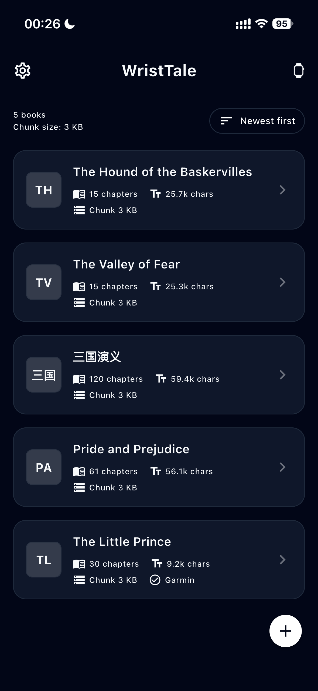](assets/phone/library.webp) | [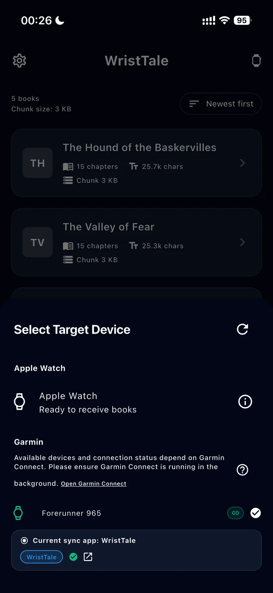](assets/phone/devices.webp) | [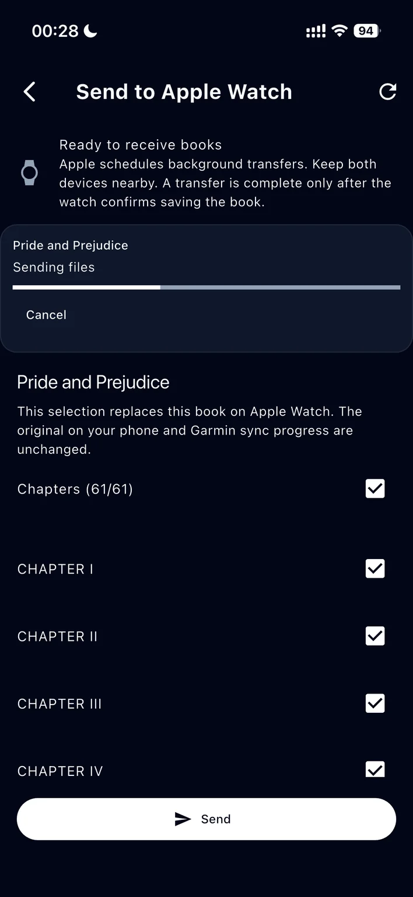](assets/phone/transfer.webp) |

### Garmin watches

Reading on a round screen.

[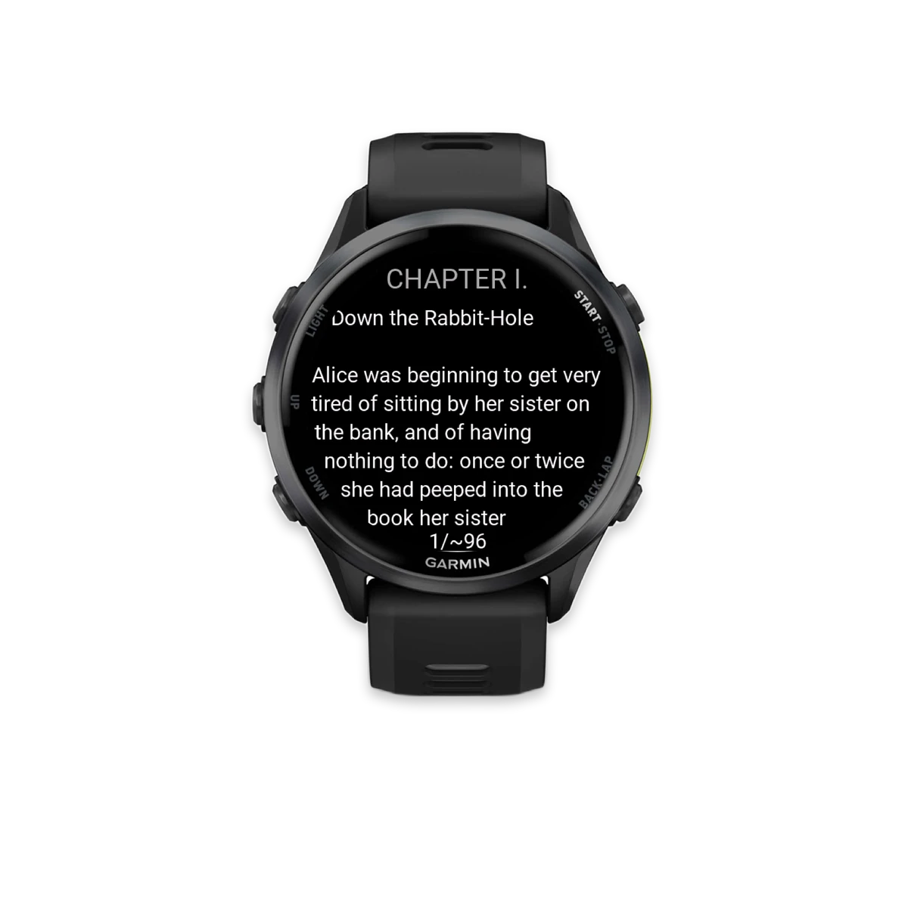](assets/garmin/reading.webp)

**Instinct 3 Solar window layout**: choose More text (allows some text obstruction) or Clear display (minimizes obstruction).

[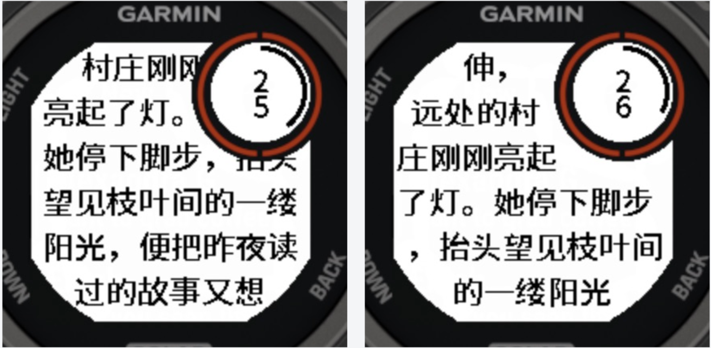](assets/garmin/instinct3-solar.webp)

### Garmin Edge bike computers

Portrait reading and landscape reading with left or right screen rotation.

| Portrait | Landscape |
| :---: | :---: |
| [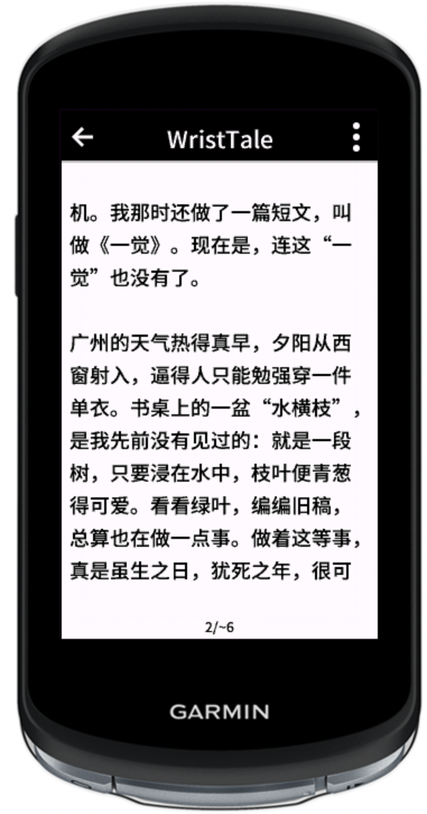](assets/edge/portrait.webp) | [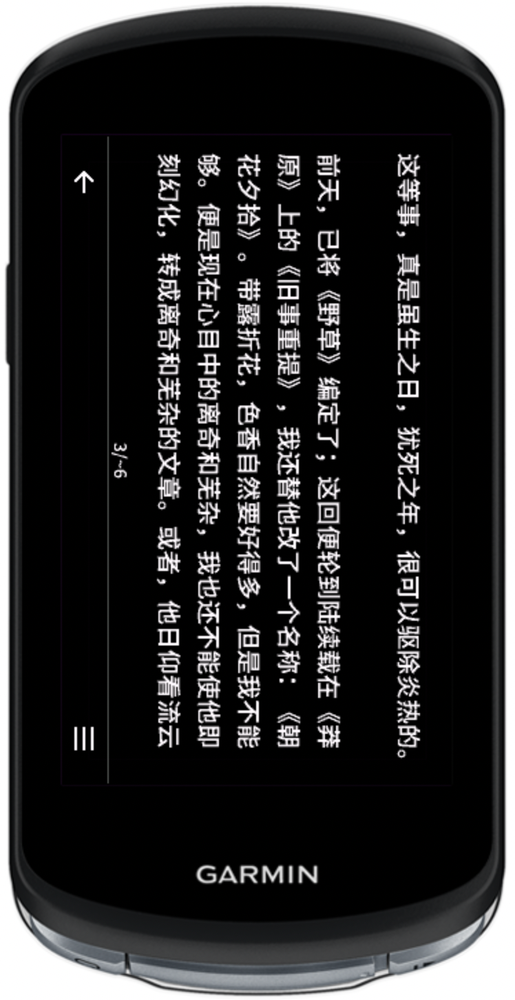](assets/edge/landscape.webp) |

### Apple Watch

Read, browse chapter progress, and adjust text size and line spacing.

| Offline reading | Contents and progress | Text settings |
| :---: | :---: | :---: |
| [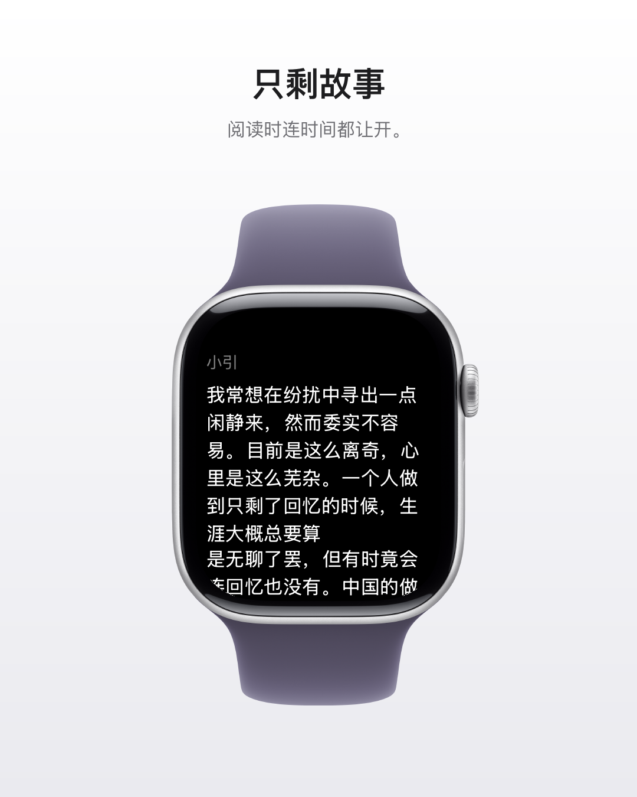](assets/apple-watch/reading.webp) | [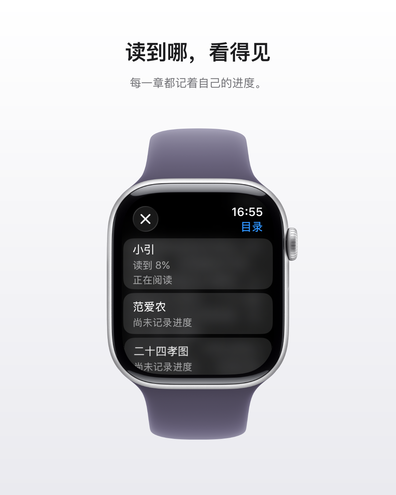](assets/apple-watch/chapters.webp) | [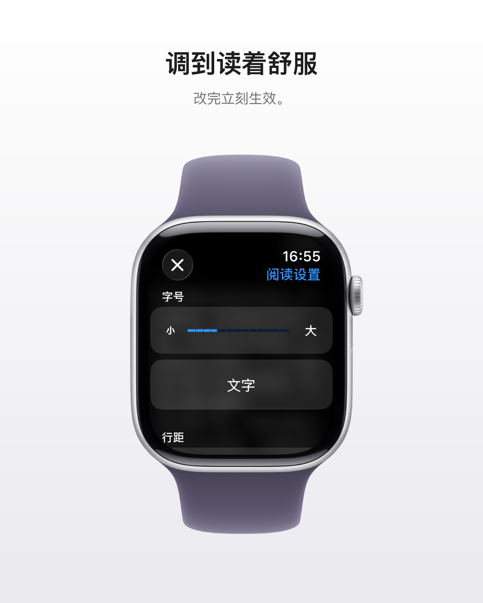](assets/apple-watch/settings.webp) |

### Android watches

The reader interface shown on Xiaomi Watch 5.

| Library | Reading |
| :---: | :---: |
| [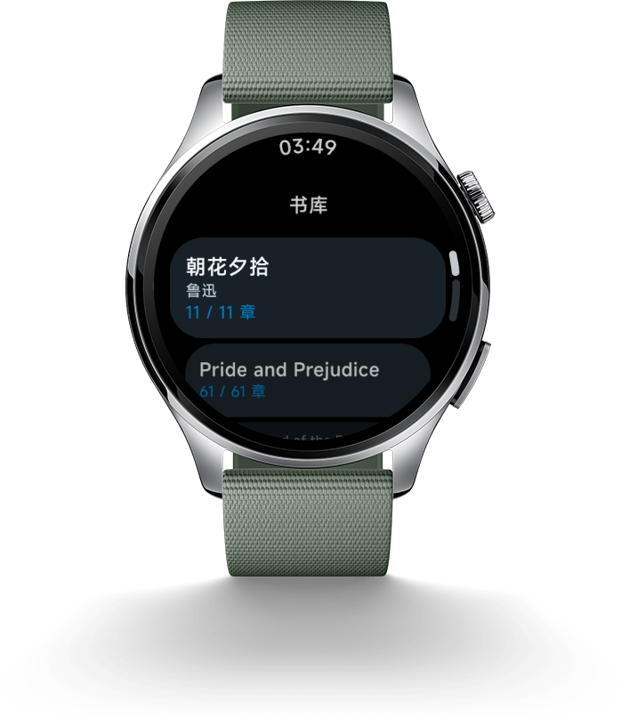](assets/android-watch/library.webp) | [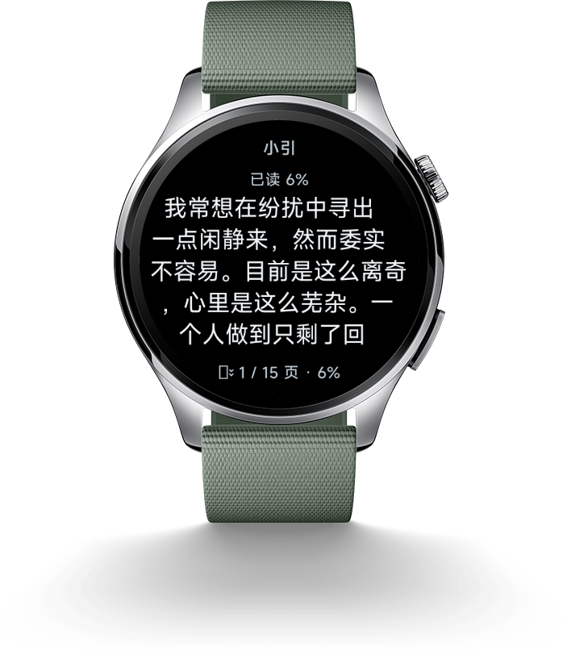](assets/android-watch/reading.webp) |

| Larger text | Warm theme |
| :---: | :---: |
| [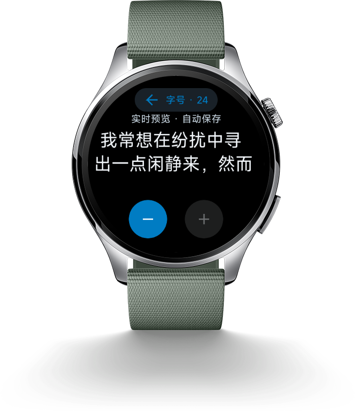](assets/android-watch/large-text.webp) | [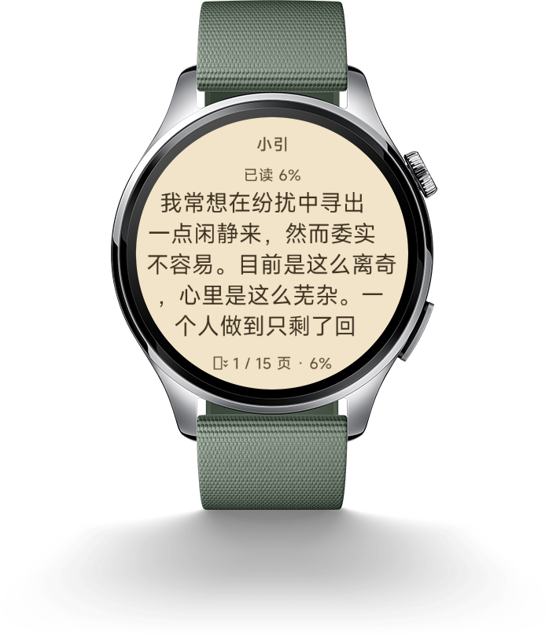](assets/android-watch/theme.webp) |

## More

[Website](https://wristtale.com/en) · [Guide](https://wristtale.com/en/guide) · [Changelog](https://wristtale.com/en/changelog) · [Support](https://wristtale.com/en/support)

Contact: <support@wristtale.com>

WristTale is a closed-source application. This repository provides the product overview, screenshots, and official download links.
